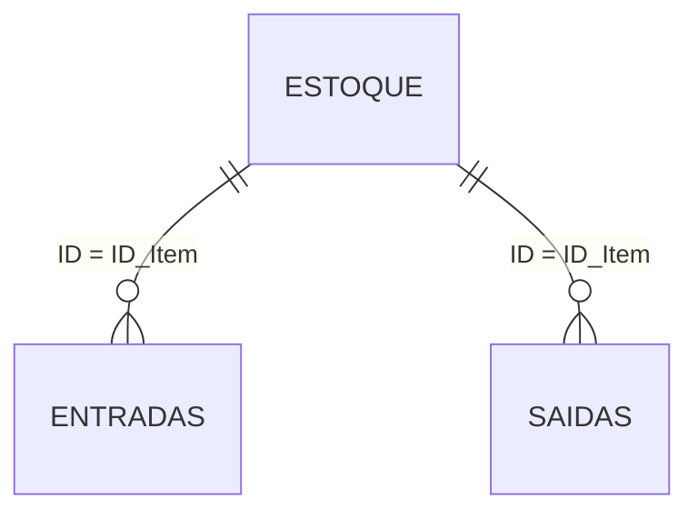

# 🧺 DoaMais — Controle Inteligente de Doações e Estoque


> MVP low-code/no-code para organizações sociais substituírem cadernos e planilhas soltas por um sistema simples de **entradas, saídas, saldo de estoque e alertas automáticos**.

**Desafio 3 — Tecnologia para o Impacto Social** · Kodie Academy · Power Developers

---

## 📑 Sumário

1. [Descrição do projeto](#-descrição-do-projeto)
2. [Links](#-links)
3. [Stack utilizada](#-stack-utilizada)
4. [Funcionalidades](#-funcionalidades)
5. [Arquitetura](#-arquitetura)
6. [Banco de dados (Google Sheets)](#-banco-de-dados-google-sheets)
7. [Fluxo de automação no Make](#-fluxo-de-automação-no-make-super-fluxo-doamais)
8. [Contrato do webhook](#-contrato-do-webhook)
9. [Prompt de IA utilizado](#-prompt-de-ia-utilizado)
10. [Como executar o projeto](#-como-executar-o-projeto)
11. [Checklist do desafio](#-checklist-do-desafio)
12. [Equipe](#-equipe)

---

## 📖 Descrição do projeto

### 1. O problema

O recebimento e a distribuição de recursos (alimentos, roupas, materiais escolares) são anotados em cadernos ou planilhas separadas. Isso resulta em **perda de dados**, **materiais vencendo no estoque** e falta de conhecimento da equipe sobre quanto foi recebido ou distribuído. Além disso, o relatório mensal para a diretoria e os doadores pode levar **até 2 dias inteiros** para ser montado manualmente.

### 2. O usuário

| Perfil                                | O que faz no dia a dia                                                                            |
| ------------------------------------- | ------------------------------------------------------------------------------------------------- |
| **Voluntários de recepção e estoque** | Registram entradas de doações, frequentemente sob pressão e com pouco tempo.                      |
| **Coordenadores de distribuição**     | Organizam os recursos que vão para as famílias e precisam saber o saldo real disponível.          |
| **Gestores / Diretoria e doadores**   | Acompanham a disponibilidade e precisam de transparência sobre entradas, saídas e impacto gerado. |

### 3. A solução

Um sistema simples de inventário e controle de recursos que registra entradas e saídas de doações, mantém o **saldo do estoque atualizado automaticamente** e monitora o volume em tempo real. O sistema dispara alertas ao coordenador sobre itens próximos da validade ou abaixo do estoque mínimo e consolida os dados para relatórios.

### 4. Resultado esperado

- Reduzir em **80%** a perda de alimentos por vencimento.
- Manter a divergência de inventário **abaixo de 5%**.
- Total transparência na gestão e facilidade na localização de itens.
- Reduzir o esforço manual de geração de relatórios de **2 dias para zero** (totalmente automático).

---

## 🔗 Links

| Recurso                               | Link                                                                                                                   |
| ------------------------------------- | ---------------------------------------------------------------------------------------------------------------------- |
| 🌐 **MVP (aplicação publicada)**      | `https://doamais.vercel.app/`                                                                                          |
| 💻 **Repositório**                    | `https://github.com/dgarauj04/DoaMais`                                                                                 |
| 📊 **Banco de dados (Google Sheets)** | [Abrir planilha](https://docs.google.com/spreadsheets/d/1BmMa4MgyXv-l6y_cs6ea2Yt26jmnoZALvQDdaLf5ON0/edit?usp=sharing) |
| ⚙️ **Automação (Make)**               | Cenário "DoaMais" — endpoint configurado via variável de ambiente (veja [Como executar](#-como-executar-o-projeto))    |

---

## 🛠️ Stack utilizada

| Camada                     | Tecnologia                                                          |
| -------------------------- | ------------------------------------------------------------------- |
| **Interface**              | Vite + React + TypeScript                                           |
| **Estilo**                 | Tailwind CSS + SCSS + shadcn/ui · fonte Inter · ícones lucide-react |
| **Gráficos**               | Recharts (gráfico de barras agrupadas responsivo)                   |
| **Banco de dados**         | Google Sheets (3 abas, saldo calculado por fórmulas `SOMASE`)       |
| **Automação / integração** | Make (Custom Webhook, Router, Google Sheets, Gmail)                 |
| **Apoio de IA**            | Prompt estruturado para gerar a primeira versão da interface        |

> A aplicação **não possui backend próprio, autenticação nem banco local**. O React conversa com o Make por webhook, e o Make lê e grava na planilha.

---

## ✨ Funcionalidades

### 📊 Dashboard (`/`)

- 4 cards de KPI: **Itens em estoque**, **Vencendo em 7 dias** (vermelho), **Abaixo do mínimo** (âmbar) e **Distribuído no mês**.
- Gráfico de barras agrupadas: **Entradas × Distribuição × Perdas** nos últimos 6 meses.
- Painel **Alertas de validade**: itens vencidos ou vencendo em até 7 dias, com badge "vence em X dias".
- Tabela **Últimas movimentações** (8 mais recentes).

### 📦 Estoque (`/estoque`)

- Filtros por nome, categoria e status (🟢 OK · 🟡 Abaixo do mínimo · 🔴 Vencendo/vencido).
- Tabela com saldo, estoque mínimo, validade mais próxima e status em badge colorida.
- Botão **Novo produto** (envia `tipo_acao: "novo_item"`) e **Registrar saída** por linha, com o item pré-selecionado.

### 🕘 Histórico (`/historico`)

- Filtros por tipo, período e busca por item, doador ou família.
- Tabela completa com colunas ordenáveis por data e quantidade e observação truncada com tooltip.
- Badges: entrada (verde), distribuição (azul), consumo (cinza), perda (vermelho).

### ➕ Nova Entrada (`/entrada`)

- Formulário com data, categoria, item (com busca e opção **"+ Cadastrar novo item"**), quantidade, unidade, tipo e contato do doador e observação.
- Campo **validade** exibido apenas para a categoria _Alimentos_.
- Validação de contato (e-mail com `@`), toast de sucesso e botão com estado de loading.

### ➖ Nova Saída (`/saida`)

- Tipos de saída: **Distribuição** (família + bairro), **Consumo interno** e **Perda** (motivo: Vencimento, Avaria, Outro).
- **Bloqueia saídas maiores que o saldo** com a mensagem "Saldo insuficiente: existem X un disponíveis".

### 🤖 Automações (Make)

- Gravação automática de entradas e saídas na planilha.
- **E-mail de agradecimento** ao doador identificado.
- **Alerta de nível crítico** ao coordenador quando `Saldo_Atual <= Estoque_Minimo`.
- Dupla checagem de saldo no servidor (evita conflito entre dois voluntários operando ao mesmo tempo).
- Regra de unicidade de produto pelo nome (erro 409 em duplicidade).

> **Regra de ouro:** a interface **nunca calcula saldo**. Ela apenas exibe o campo `saldo_atual` vindo da planilha.

---

## 🗄️ Banco de dados (Google Sheets)

Planilha com **3 abas**. O saldo é calculado **somente por fórmulas nativas** (sem macros ou scripts).

### Aba `Estoque`

| Coluna                  | Descrição                                                               |
| ----------------------- | ----------------------------------------------------------------------- |
| `ID`                    | Identificador do item (ex.: `ITM-001`)                                  |
| `Nome`                  | Nome do item                                                            |
| `Categoria`             | Alimentos, Higiene, Roupas, Material Escolar etc.                       |
| `Unidade`               | kg, L, un, caixa, pacote                                                |
| `Controla_Validade`     | `TRUE` / `FALSE`                                                        |
| `Estoque_Minimo`        | Nível mínimo para disparar alerta                                       |
| `Total_Entradas`        | `SOMASE` sobre a aba Entradas                                           |
| `Total_Saidas`          | `SOMASE` sobre a aba Saidas                                             |
| `Saldo_Atual`           | `Total_Entradas - Total_Saidas`                                         |
| `Validade_Mais_Proxima` | Menor validade de lote do item (apenas se controla validade e há saldo) |

Fórmulas da linha 2:

```
Total_Entradas (G2): =SOMASE(Entradas!$C$2:$C$1000;A2;Entradas!$E$2:$E$1000)
Total_Saidas   (H2): =SOMASE(Saidas!$D$2:$D$1000;A2;Saidas!$F$2:$F$1000)
Saldo_Atual    (I2): =G2-H2
```

### Aba `Entradas`

`ID_Movimentacao` · `Data` · `ID_Item` · `Item_Nome` · `Quantidade` · `Doador_Tipo` · `Doador_Nome` · `Doador_Contato` · `Validade_Lote` · `Observacao`

### Aba `Saidas`

`ID_Movimentacao` · `Data` · `Tipo_Saida` · `ID_Item` · `Item_Nome` · `Quantidade` · `Familia_Nome` · `Bairro` · `Motivo_Perda` · `Responsavel` · `Observacao`

### Relacionamento



---

## ⚙️ Fluxo de automação no Make (Super-Fluxo "DoaMais")

Cenário único em versão híbrida: o React faz a validação básica e o Make faz a **dupla checagem** e as automações.


### Módulo 1 — Custom Webhook

Ponto de entrada. Recebe o JSON enviado pelo formulário do React (que já valida, por exemplo, que a saída não excede o saldo disponível).

### Módulo 2 — Router

Divide o fluxo conforme a variável `tipo_acao`.

### ➡️ Caminho A — Entrada (`tipo_acao = entrada`)

| Módulo                             | Função                                                                                                                                         |
| ---------------------------------- | ---------------------------------------------------------------------------------------------------------------------------------------------- |
| **3A · Google Sheets (Add a Row)** | Grava os dados na aba `Entradas`.                                                                                                              |
| **4A · Webhook Response**          | Responde `200 OK` ao React com `status`, `id_movimentacao`, `item_nome` e `quantidade`.                                                      |
| **5A · Router (sub-rota)**         | O Make continua em background. Filtro: `doador_tipo` ≠ Anônimo **e** `doador_contato` contém `@`.                                              |
| **6A · Gmail (Send an Email)**     | Envia o e-mail de agradecimento ("Olá [Doador_Nome], o DoaMais agradece..."). Com tratamento de erro para o fluxo não parar se o Gmail falhar. |

### ➡️ Caminho B — Saída (`tipo_acao = saida`)

| Módulo                               | Função                                                                                                                  |
| ------------------------------------ | ----------------------------------------------------------------------------------------------------------------------- |
| **3B · Google Sheets (Search Rows)** | Confirma na aba `Estoque` se o saldo ainda é suficiente (dupla checagem para operações simultâneas).                    |
| **4B · Router (condicional)**        | Se `quantidade > Saldo_Atual`: devolve **erro 400** ao React e **para o fluxo sem gravar nada**. Se válida: continua. |
| **5B · Google Sheets (Add a Row)**   | Registra a saída na aba `Saidas`.                                                                                       |
| **6B · Webhook Response**            | Responde `200 OK` ao React.js.                                                                                           |
| **7B · Google Sheets (Search Rows)** | Lê o novo `Saldo_Atual` na aba `Estoque`.                                                                               |
| **8B · Router (alerta)**             | Filtro: `Saldo_Atual <= Estoque_Minimo`.                                                                                |
| **9B · Gmail (Send an Email)**       | Dispara o alerta de nível crítico para o coordenador da ONG.                                                            |

### ➡️ Caminho C — Novo item (`tipo_acao = novo_item`)

| Módulo                               | Função                                                                             |
| ------------------------------------ | ---------------------------------------------------------------------------------- |
| **3C · Google Sheets (Search Rows)** | Procura se o produto já existe na aba `Estoque` (unicidade pelo nome).             |
| **4C · Router (condicional)**        | Se já existe: devolve **erro 409 (Conflito)** ao React. Se não existe: continua. |
| **5C · Google Sheets (Add a Row)**   | Registra o novo item em `Estoque`, gerando ID único e mantendo as fórmulas.        |
| **6C · Webhook Response**            | Responde `200 OK` com o ID do novo produto.                                        |

### Automações planejadas (evolução)

- Varredura diária com alerta por WhatsApp/e-mail de itens que vencem em 7 dias.
- Gatilho semanal que envia o relatório consolidado à diretoria.

---

## 🔌 Contrato do webhook

Toda requisição é um `POST` em JSON e **sempre** contém a chave `tipo_acao`.

| `tipo_acao` | Quando é enviado                                |
| ----------- | ----------------------------------------------- |
| `entrada`   | Formulário "Nova Entrada"                       |
| `saida`     | Formulário "Nova Saída"                         |
| `novo_item` | Botão "Novo produto" ou "+ Cadastrar novo item" |

Exemplo ilustrativo (entrada):

```json
{
  "tipo_acao": "entrada",
  "data": "2026-10-14",
  "item_id": "ITM-001",
  "quantidade": 20,
  "doador_tipo": "Empresa",
  "doador_nome": "Supermercado Bom Preço",
  "doador_contato": "contato@exemplo.com",
  "validade_lote": "2027-03-15",
  "observacao": ""
}
```

Respostas tratadas pela interface:

| Código | Significado                                                      |
| ------ | ---------------------------------------------------------------- |
| `200`  | Sucesso (`status`, `id_movimentacao`, `item_nome`, `quantidade`) |
| `400`  | Saldo insuficiente (saída bloqueada pelo Make)                   |
| `409`  | Produto já cadastrado                                            |

---

## 🤖 Prompt de IA utilizado

O prompt abaixo foi usado para gerar a primeira versão da aplicação, que depois foi testada, ajustada e conectada ao Make.

<details>
<summary><strong>Clique para ver o prompt completo</strong></summary>

```text
Construa uma aplicação web chamada "DoaMais" — sistema de controle de doações e estoque para uma organização social comunitária. Ela substitui um caderno de anotações: registra entradas de doações, saídas (distribuição, consumo e perdas), mantém o saldo de estoque e exibe um painel de acompanhamento.

## Stack e regras técnicas
- Vite + React + TypeScript + Tailwind + SCSS + componentes shadcn/ui. Gráficos com Recharts.
- NÃO crie backend próprio, autenticação, banco de dados ou multiusuário. Não use Prisma nem qualquer banco local.
- Crie uma camada de dados isolada em `lib/data.ts` com as funções: `getItens()`, `getMovimentacoes()`, `enviarEntrada(dados)`, `enviarSaida(dados)`, `criarItem(dados)`.
  - Por enquanto, `getItens()` e `getMovimentacoes()` retornam dados de exemplo (mock) realistas em português do Brasil.
  - `enviarEntrada`, `enviarSaida` e `criarItem` devem fazer `fetch POST` em JSON para URLs lidas de variáveis de ambiente (`VITE_WEBHOOK_ENTRADA`, `VITE_WEBHOOK_SAIDA`, `VITE_WEBHOOK_NOVO_ITEM`). O JSON deve sempre incluir uma chave `"tipo_acao"` (valores: "entrada", "saida", "novo_item"). Se as variáveis de ambiente não existirem, simule sucesso após 800ms (para demonstração).
- Deixe as variáveis de ambiente documentadas em comentário no topo de `lib/data.ts`.
- O React atua como o principal validador (ex: impedindo saídas maiores que o saldo), mas deve estar preparado para tratar erros devolvidos pelo Webhook.
- A UI NUNCA calcula saldo: ela consome o campo `saldo_atual` que já vem pronto da fonte de dados.

## Modelo de dados (tipos TypeScript)
- Item: { id, item_nome, categoria ("Alimentos" | "Higiene" | "Roupa" | "Material Escolar" | "Outro"), unidade ("kg" | "L" | "un" | "caixa" | "pacote"), controla_validade (boolean), estoque_minimo (number), saldo_atual (number), validade_mais_proxima (string data | null) }
- Movimentacao: { id, data (string), tipo ("entrada" | "distribuicao" | "consumo" | "perda"), item_id, item_nome, quantidade (number - deve ser sempre positiva), unidade, doador_tipo? ("Pessoa" | "Empresa" | "Anônimo"), doador_nome?, doador_contato? (string), validade_lote?, familia_nome?, familia_bairro?, responsavel?, motivo_perda? (string), observacao? }

## Layout global
- Sidebar fixa à esquerda (desktop) com logo "DoaMais" e navegação: Dashboard, Estoque, Histórico, e um grupo "Registrar" com Nova Entrada e Nova Saída. Em mobile, sidebar vira menu hambúrguer.
- Topo com botões de ação rápida "Nova Entrada" e "Nova Saída" visíveis em todas as páginas.
- Ícones lucide-react. Toda a interface em português do Brasil.

## Página 1 — Dashboard ("/")
Painel de acompanhamento, denso mas organizado em grid:
1. Linha de 4 cards KPI: "Itens em estoque" (soma de itens distintos), "Vencendo em 7 dias" (card com borda/texto vermelho), "Abaixo do mínimo" (âmbar), "Distribuído no mês" (total de unidades com tipo distribuicao no mês atual).
2. Gráfico de barras agrupadas: Entradas vs Distribuição vs Perdas por mês (últimos 6 meses).
3. Painel lateral "Alertas de validade": lista dos itens com validade_mais_proxima em até 7 dias ou vencidos — item, saldo, data, e badge "vence em X dias" (vermelho se vencido). Estado vazio amigável se não houver alertas.
4. Tabela "Últimas movimentações" (8 mais recentes): data, tipo (badge colorida), item, quantidade, origem/destino.

## Página 2 — Estoque ("/estoque")
- Filtros no topo: busca por nome do item, select de categoria, select de status (Todos / 🟢 OK / 🟡 Abaixo do mínimo / 🔴 Vencendo ou vencido).
- Tabela: Item, Categoria, Saldo (número + unidade), Estoque mínimo, Validade mais próxima, Status (badge colorida). Item abaixo do mínimo = 🟡; com validade em até 7 dias ou vencida = 🔴 (vermelho tem prioridade sobre amarelo).
- Botão "Novo produto" (que chama a função `criarItem` passando tipo_acao: "novo_item").
- Botão "Registrar saída" em cada linha que leva a /saida com o item pré-selecionado.
- Campo de saldo com destaque quando abaixo do mínimo.

## Página 3 — Histórico ("/historico")
- Filtros: tipo de movimentação, período (data início/fim), busca por item ou doador/família.
- Tabela completa: Data, Tipo (badge: entrada=verde, distribuição=azul, consumo=cinza, perda=vermelho), Item, Quantidade, Origem/Destino (doador se entrada; família se distribuição), Responsável, Observação (truncada com tooltip).
- Colunas ordenáveis por data e quantidade.

## Página 4 — Registrar Doação ("/entrada")
Formulário em card único, máximo 2 colunas:
- Data (default: hoje) | Categoria (select) | Item (select com busca; opção "+ Cadastrar novo item" que abre campos inline: nome, unidade, estoque mínimo)
- Quantidade (number, obrigatório, > 0) | Unidade (herdada do item) | Validade (date) — o campo validade SÓ aparece quando categoria = "Alimentos", com label "Validade (opcional)".
- Tipo de doador: radio "Pessoa / Empresa / Anônimo" — se Anônimo, oculta o campo nome; campo "Contato do doador" opcional (mas validado se contiver @) | Observação (textarea)
- Ao submeter: o front-end valida os campos, chama `enviarEntrada` (passando tipo_acao: "entrada"), mostra toast de sucesso e limpa o formulário. Botão com estado de loading.

## Página 5 — Nova Saída ("/saida")
- Data (default: hoje) | Tipo de saída: 3 cards selecionáveis com ícone: "Distribuição" (para família), "Consumo interno", "Perda"
- Item (select com busca, mostrando "nome — saldo atual unidade" em cada opção).
- Quantidade (number): o front-end deve validar estritamente se `quantidade <= saldo_atual` do item selecionado. Se exceder, mostrar erro inline "Saldo insuficiente: existem X un disponíveis" e bloquear o envio.
- Se tipo = "Distribuição": campos "Família beneficiada" (texto com autocomplete) e "Bairro" | Se "Perda": select de "Motivo da perda" (Vencimento, Avaria, Outro).
- Responsável (texto) e Observação (Destino ou finalidade).
- Ao submeter: valida, chama `enviarSaida` (passando tipo_acao: "saida"), mostra toast e limpa.

## Estilo visual
- Identidade de organização social: confiável, acolhedor e limpo.
- Primário verde escuro (emerald-700) para ações; âmbar para avisos; vermelho para situações críticas; fundo cinza-neutro claro (stone-50) com cards brancos.
- Fonte Inter.

## Banco de Dados no Google Sheets (Para referência do código de integração)
O sistema vai integrar-se com uma planilha de 3 abas:
1. 'Estoque': ID, Nome, Categoria, Unidade, Controla_Validade (TRUE/FALSE), Estoque_Minimo, Total_Entradas (SOMASE), Total_Saidas (SOMASE), Saldo_Atual (Entradas-Saidas), Validade_Mais_Proxima.
2. 'Entradas': ID_Movimentacao, Data, ID_Item, Item_Nome, Quantidade, Doador_Tipo, Doador_Nome, Doador_Contato, Validade_Lote, Observacao.
3. 'Saidas': ID_Movimentacao, Data, Tipo_Saida, ID_Item, Item_Nome, Quantidade, Familia_Nome, Bairro, Motivo_Perda, Responsavel, Observacao.

## Dados de exemplo (mock)
Crie ~15 itens variados: arroz 5kg (caixa, saldo 12, mínimo 5), feijão (kg, 30, 10), leite UHT (un, 48, 24, validade próxima), macarrão, óleo, enlatados, sabonete, detergente, cobertores (abaixo do mínimo), camisetas, cadernos. Deixe 3 itens com validade em menos de 7 dias e 1 vencido. Gere ~40 movimentações.

## Não incluir
Login, autenticação, Prisma, banco local. Build sem erros e responsivo.

## APIs
API Webhook DoaMais: <URL_DO_WEBHOOK_DO_MAKE>
Google Sheets: <URL_DA_PLANILHA>
```

</details>

> 💡 **Uso responsável da IA:** a IA foi usada como apoio para estruturar a interface e a arquitetura. A lógica, os testes, as integrações com o Make e a planilha foram feitos, revisados e validados por mim.

---

## 📁 Estrutura do Projeto

```
doamais/
├── index.html                   # Ponto de entrada HTML do Vite
├── vite.config.ts               # Configuração do Vite, Tailwind v4 e Aliases
├── tsconfig.json                # Configuração TypeScript
├── package.json                 # Dependências e scripts
├── .env.local                   # Configuração das URLs de Webhook
├── src/
│   ├── main.tsx                 # Inicialização do React 19
│   ├── App.tsx                  # Shell da aplicação e rotas (React Router)
│   ├── index.css                # Tailwind CSS v4 e variáveis de tema
│   ├── styles/
│   │   └── custom.scss          # SCSS customizado com animações e KPIs
│   ├── pages/
│   │   ├── DashboardPage.tsx    # Painel de acompanhamento (KPIs + Gráfico)
│   │   ├── EstoquePage.tsx      # Tabela de estoque e filtros
│   │   ├── HistoricoPage.tsx    # Auditoria de movimentações ordenável
│   │   ├── EntradaPage.tsx      # Formulário de entrada de doação
│   │   └── SaidaPage.tsx        # Formulário de saída com validação
│   ├── components/
│   │   ├── layout/
│   │   │   ├── sidebar.tsx      # Menu lateral fixo / hambúrguer mobile
│   │   │   └── header.tsx       # Ações rápidas superiores
│   │   ├── ui/                  # Componentes reutilizáveis (Card, Button, Badge, etc.)
│   │   └── common/
│   │       └── novo-item-dialog.tsx # Modal de novo produto
│   └── lib/
│       ├── data.ts              # Camada de dados, mocks e integração Webhook
│       └── utils.ts             # Formatadores e utilitários
```

---

## 🚀 Como executar o projeto

### Pré-requisitos

- Node.js 18 ou superior
- Conta no Make com o cenário "DoaMais" ativo
- Planilha Google Sheets com as 3 abas descritas acima

### Passo a passo

```bash
# 1. Clone o repositório
git clone https://github.com/dgarauj04/DoaMais.git
cd doamais

# 2. Instale as dependências
npm install

# 3. Configure as variáveis de ambiente
cp .env.example .env.local

# 4. Rode em modo de desenvolvimento
npm run dev
```

Acesse `http://localhost:3000`.

### Variáveis de ambiente (`.env.local`)

```env
VITE_WEBHOOK_ENTRADA=https://hook.us2.make.com/SEU_ID_DO_WEBHOOK
VITE_WEBHOOK_SAIDA=https://hook.us2.make.com/SEU_ID_DO_WEBHOOK
VITE_WEBHOOK_NOVO_ITEM=https://hook.us2.make.com/SEU_ID_DO_WEBHOOK
```

> Como o Make usa **um único webhook** com Router por `tipo_acao`, as três variáveis podem apontar para a mesma URL.
> Sem as variáveis, a aplicação roda em **modo demonstração**: usa dados de exemplo e simula sucesso após 800 ms.
> ⚠️ Não publique a URL real do webhook no repositório. Mantenha-a apenas em `.env.local` e nas variáveis do serviço de deploy.

---

## ✅ Checklist do desafio

- [x] O problema está claro
- [x] É possível entender quem utiliza a solução
- [x] Interface funcional (React)
- [x] Formulários de entrada e saída funcionando
- [x] Dados armazenados em banco (Google Sheets)
- [x] Workflow principal funcionando (Make: entrada, saída e novo item)
- [x] Visualização e acompanhamento dos dados (Dashboard, Estoque e Histórico)
- [x] Funcionalidades coerentes com o problema escolhido
- [x] Integrantes identificados no projeto
- [x] Link do MVP conferido e acessível

---

## 👥 Equipe

| Nome                                                                                      | Papel                                                     |
| ----------------------------------------------------------------------------------------- | --------------------------------------------------------- |
| **[Douglas Araujo](https://github.com/dgarauj04)** — Dev Fullstack/Engenheiro de Software | Desenvolvimento, engenheiro de prompt, automação e design |

---

<p align="center">
  <strong>EMPATIA → EFICIÊNCIA → RESULTADO</strong><br/>
  <em>A tecnologia é o meio. O problema é o ponto de partida.</em>
</p>
